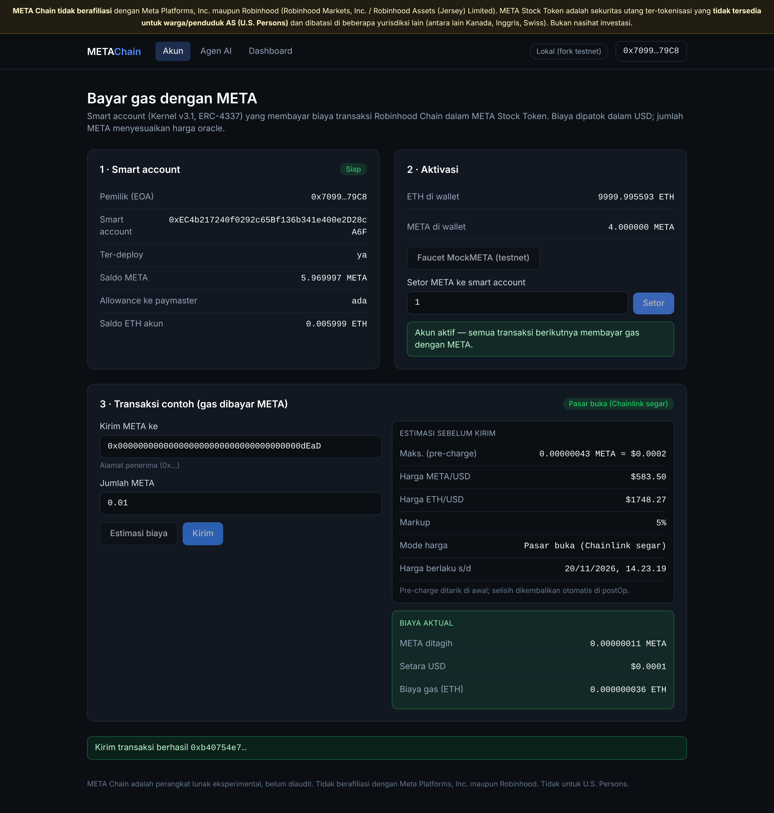

# META Chain

Lapisan pembayaran gas di **Robinhood Chain** (Arbitrum Orbit L2). Dengan META Chain, pengguna dan agen AI bisa membayar
biaya transaksi memakai **META Stock Token** (token saham Meta Platforms ter-tokenisasi yang diterbitkan Robinhood Assets
(Jersey) Limited), lewat paymaster ERC-4337.

Biaya dipatok dalam **USD**. Jumlah META yang ditarik menyesuaikan harga saham dari oracle hibrida (Chainlink + TWAP
Uniswap V3 dengan circuit breaker).

> ⚠️ **Disclaimer.** META Chain adalah proyek independen dan **tidak berafiliasi, didukung, maupun disponsori** oleh
> Meta Platforms, Inc. atau Robinhood (Robinhood Markets, Inc. / Robinhood Assets (Jersey) Limited).
> META Stock Token adalah sekuritas utang ter-tokenisasi yang **tidak tersedia untuk U.S. Persons** dan dibatasi di
> beberapa yurisdiksi lain (antara lain Kanada, Inggris, Swiss). Perangkat lunak ini eksperimental dan **belum diaudit**.
> Bukan nasihat investasi.



## Isi repositori

| Path | Isi |
|---|---|
| `contracts/` | Foundry: `MetaTokenPaymaster`, `MetaPriceOracle`, `AgentPayments`, mock testnet, tes, skrip deploy |
| `packages/sdk/` | `@metachain/sdk` (TypeScript, viem + permissionless + Rhinestone module-sdk) |
| `apps/web/` | Frontend Next.js + wagmi + Tailwind: halaman Akun, Agen AI, dan Dashboard publik |
| `docs/feasibility.md` | Riset kelayakan Fase 0, dengan semua temuan diverifikasi on-chain |
| `docs/addresses.md` | Semua alamat yang dipakai, beserta status verifikasinya |
| `docs/security/slither.md` | Laporan & triase Slither |
| `docs/runbook.md` | Runbook operasional & darurat (pause, oracle, refund, risiko penerbit) |
| `docs/pre-mainnet-checklist.md` | Checklist sebelum mainnet (audit, hukum, monitoring) |
| `scripts/e2e-local.sh` | Menyalakan stack lokal lengkap: anvil fork testnet, deploy, bundler Alto |

## Arsitektur

```
 Pengguna (wallet EOA)              Agen AI (hanya memegang session key)
        │ tanda tangan pemilik               │ tanda tangan session key
        ▼                                    ▼
 ┌──────────────────────── Smart account Kernel v3.1 (ERC-7579) ─────────────────────────┐
 │ validator root: ECDSA (pemilik)   validator: Rhinestone Smart Sessions (agen)          │
 │                                     ├─ hanya boleh memanggil AgentPayments.pay        │
 │                                     ├─ TimeFramePolicy (masa berlaku)                  │
 │                                     └─ UsageLimitPolicy (jumlah pemakaian)             │
 └───────────────────────────────────────┬───────────────────────────────────────────────┘
                                         │ UserOperation (paymasterAndData → MetaTokenPaymaster)
                                         ▼
                      Bundler (Pimlico / Alchemy; Alto untuk lokal)
                                         ▼
                 EntryPoint v0.7  0x0000000071727De22E5E9d8BAf0edAc6f37da032
                     │ validatePaymasterUserOp            │ postOp
                     ▼                                    ▼
 ┌────────────────────────────── MetaTokenPaymaster ───────────────────────────────┐
 │ validasi: baca cache harga (tanpa TIMESTAMP) → pre-charge META (transferFrom)    │
 │          → validUntil = batas umur harga; validAfter = batas user per periode    │
 │ postOp  : biaya aktual (+overhead postOp +batas penalti 10% gas tak terpakai)    │
 │          → refund selisih (gagal? dicatat sebagai owedRefunds, bisa diklaim)     │
 │ admin   : Ownable2Step, pause, markup, batas per op & per user, deposit/stake     │
 └───────────────┬─────────────────────────────────────────────────────────────────┘
                 │ updatePrice() (permissionless, oleh keeper)
                 ▼
 ┌──────────────────────────────── MetaPriceOracle ─────────────────────────────────┐
 │ Chainlink "Robinhood META / USD" (harga per token, multiplier sudah termasuk)    │
 │ Chainlink ETH/USD, USDG/USD · TWAP 30 mnt Uniswap V3 META/USDG (0,3%)             │
 │ mode: Open (<1 jam) · Closed (<80 jam, wajib cek TWAP) · Fallback (TWAP saja)     │
 │ circuit breaker: |Chainlink − TWAP| > 3% (Open) / 8% (Closed) → tolak             │
 └──────────────────────────────────────────────────────────────────────────────────┘
 AgentPayments: pembayaran agen-ke-agen (META/USDG) + receipt (payer, payee, amount, memoHash);
                batas per periode (jumlah, USD, jumlah tx) ditegakkan saat eksekusi.
```

### Keputusan desain penting (dan alasannya)

1. **EntryPoint v0.7**: ter-deploy di mainnet & testnet, didukung Pimlico dan Alchemy.
2. **Kernel v3.1, bukan Safe**: adapter Safe7579 ada di mainnet, tetapi **launchpad**-nya tidak ada di kedua jaringan dan
   tidak ada sama sekali di testnet. Kernel v3.1 beserta validator ECDSA-nya ter-deploy di keduanya (`docs/addresses.md`).
   Session key tetap memakai **Rhinestone Smart Sessions** sesuai rencana.
3. **TWAP Uniswap V3, bukan V4**: pool V4 yang likuid tidak memakai hook oracle, sehingga tidak menyimpan observasi.
   Pool V3 META/USDG 0,3% sudah punya kardinalitas observasi 3601.
4. **Harga di-cache, bukan dibaca saat validasi**: ERC-7562 melarang `TIMESTAMP` saat validasi. Harga lengkap dihitung di
   `updatePrice()`, lalu validasi mengembalikan `validUntil` yang ditegakkan EntryPoint sendiri.
5. **Batas belanja agen per periode ditegakkan di `AgentPayments`** (saat eksekusi), karena validasi session key juga
   tidak boleh membaca jam.
6. **Operasi pertama dibayar ETH**: paymaster menarik META dengan `transferFrom` saat validasi, sementara token META
   (`permit` berbasis ECDSA) tidak bisa ditandatangani oleh smart contract. Akun baru tetap butuh satu operasi
   deploy+approve yang dibayar ETH (atau disponsori pihak lain).

## Cara kerja harga

```
biaya_gas_wei = actualGasCost + (postOpOverheadGas + 10% × (callGasLimit + postOpGasLimit − postOpOverheadGas)) × gasPrice
biaya_usd     = ceil(biaya_gas_wei × ETH/USD / 1e18)
META          = ceil(biaya_usd × (1 + markup) / META_USD)          (META_USD = harga per token dari oracle)
markup        = 5% (Open) · 10% (Closed) · 15% (Fallback)           (bisa dikonfigurasi; maks. 50%)
```

- Saat validasi, paymaster **pre-charge** biaya terburuk (`maxCost` dari EntryPoint). Setelah eksekusi, selisihnya
  dikembalikan di postOp. Pengguna bisa menetapkan plafon `maxMetaCost` di `paymasterData`; SDK melakukannya otomatis
  dengan toleransi 2%.
- Komponen 10% adalah batas atas **penalti gas tak terpakai** EntryPoint v0.7 (tidak termasuk di `actualGasCost`).
  Karena itu paymaster tidak pernah rugi, dan kelebihan tagih paling banyak 10% dari gas call yang benar-benar terpakai.
- **Pasar tutup** (weekend/libur): Chainlink tidak update. Harga terakhir tetap dipakai hingga 80 jam, dengan cek TWAP
  wajib, markup lebih tinggi, dan batas per op lebih rendah ($1). Lewat dari itu, atau saat issuer mem-pause oracle (aksi
  korporasi), sistem masuk mode **Fallback** (TWAP saja, berlaku 5 menit per update) atau berhenti bila fallback
  dimatikan.
- Biaya nyata di Robinhood Chain sangat kecil. Fork test mainnet: **≈ 0,0000143 META (≈ $0,008)** per UserOperation
  sederhana. Demo lokal: 0,0000001–0,000004 META.

## Mulai cepat

Prasyarat: Node ≥ 20, Foundry (`npm i -g @foundry-rs/forge @foundry-rs/anvil @foundry-rs/cast` atau `foundryup`).

```bash
git clone --recurse-submodules <repo> && cd metachain
```

```bash
npm install
```

```bash
(cd contracts && forge build) && npm run gen:abis && npm run build
```

### Tes

| Perintah | Isi | Hasil terakhir |
|---|---|---|
| `cd contracts && forge test` | unit + fuzz (1.000 run) kontrak | **72/72 lulus** |
| `cd contracts && ROBINHOOD_RPC_URL=https://rpc.mainnet.chain.robinhood.com forge test --match-path "test/fork/*"` | fork test read-only Robinhood mainnet (META, Chainlink, TWAP V3, EntryPoint asli) | **4/4 lulus** |
| `npm test` | unit test SDK | **13/13 lulus** |
| `scripts/e2e-local.sh test` | e2e SDK: anvil fork testnet + deploy + bundler Alto (Kernel, Smart Sessions asli) | **7/7 lulus** |
| `scripts/e2e-local.sh example` | contoh agen AI otonom | 3 pembayaran sukses, ke-4 ditolak batas on-chain |
| `scripts/e2e-local.sh up` lalu `node apps/web/e2e/ui-flow.mjs` | uji browser (Playwright) seluruh UI | lulus |
| `cd contracts && slither . --filter-paths "lib/\|test/\|script/\|src/mocks/"` | analisis statis | lihat `docs/security/slither.md` |

### Demo lokal (tanpa dana nyata)

```bash
scripts/e2e-local.sh up
```

Perintah di atas menyalakan anvil fork testnet + kontrak + bundler, sekaligus menulis `apps/web/.env.local`. Di terminal
lain:

```bash
npm run dev -w @metachain/web
```

Buka http://localhost:3000, lalu impor akun dev anvil #1 (kunci uji publik) ke MetaMask dengan jaringan
`http://127.0.0.1:8545` (chain id 46630).

## Integrasi untuk developer

```ts
import { createPublicClient, http } from "viem";
import {
  createMetaSmartAccount, createMetaAccountClient, approveMetaCall, createBootstrapClient,
  estimateMetaFee, parseMetaGasPaid, robinhoodTestnet, addressesFromDeployment,
} from "@metachain/sdk";

const client = createPublicClient({ chain: robinhoodTestnet, transport: http() });
const addresses = addressesFromDeployment(deploymentJson);       // contracts/deployments/robinhood-testnet.json
const account = await createMetaSmartAccount({ client, owner });   // Kernel v3.1

// sekali saja: deploy + approve (dibayar ETH di smart account)
const boot = createBootstrapClient({ account, chain: robinhoodTestnet, client, bundlerUrl });
await boot.sendUserOperation({ calls: [approveMetaCall(addresses)] });

// seterusnya: gas dibayar META
const meta = createMetaAccountClient({ account, chain: robinhoodTestnet, client, bundlerUrl, addresses });
const hash = await meta.sendUserOperation({ calls: [{ to, data, value: 0n }] });
const receipt = await meta.waitForUserOperationReceipt({ hash });
console.log(parseMetaGasPaid(receipt.logs, addresses.paymaster)?.metaCharged);
```

Session key berbatas untuk agen AI, dan agen yang membayar otonom: lihat [`packages/sdk/README.md`](packages/sdk/README.md)
dan [`packages/sdk/examples/agent-autonomous-payments.ts`](packages/sdk/examples/agent-autonomous-payments.ts).

## Deploy

### Testnet (Robinhood Chain Testnet, 46630)

META tidak ada di testnet, jadi skrip men-deploy `MockMETA` (18 desimal, `permit`, pause, blocklist, `uiMultiplier`,
`oraclePaused`, faucet), feed mock, dan pool mock, plus oracle, paymaster, dan AgentPayments asli. EntryPoint, Kernel, dan
Smart Sessions memakai yang sudah ada di testnet.

```bash
cp contracts/.env.example contracts/.env
```

Isi `PRIVATE_KEY` (dengan ETH testnet, ±0,03 ETH) dan `OWNER` di file itu, lalu:

```bash
cd contracts && forge script script/Deploy.s.sol:DeployTestnet --rpc-url robinhood_testnet --broadcast --verify --verifier blockscout --verifier-url https://explorer.testnet.chain.robinhood.com/api/
```

Hasilnya `contracts/deployments/robinhood-testnet.json`. Langkah setelah deploy:

1. Bila `OWNER` ≠ deployer, owner memanggil `acceptOwnership()` pada paymaster.
2. Jalankan keeper `updatePrice()` (`docs/runbook.md` §2). Di testnet, feed mock juga perlu di-update (`setAnswer`).
3. Isi `NEXT_PUBLIC_DEPLOYMENT_JSON` dan `BUNDLER_RPC_URL` (Pimlico `robinhood-testnet`) untuk frontend.
4. Tambahkan alamatnya ke `DEPLOYMENTS` di `packages/sdk/src/addresses.ts`.

Skrip ini sudah diuji penuh pada anvil fork testnet (`scripts/e2e-local.sh`). Biaya gas deploy ≈ 0,0003 ETH, ditambah
deposit 0,02 ETH dan stake 0,005 ETH.

### Website (Vercel)

1. Di Vercel: **Add New Project** → impor repo ini → **Root Directory = `apps/web`**. Framework terdeteksi Next.js;
   `apps/web/vercel.json` meng-install dari root monorepo (`npm ci`). SDK dikonsumsi langsung dari source, jadi tidak
   ada langkah build terpisah.
2. Environment variables:
   - `NEXT_PUBLIC_NETWORK` = `mainnet` (default bila kosong)
   - `NEXT_PUBLIC_DEPLOYMENT_JSON` = isi `contracts/deployments/robinhood-mainnet.json` (setelah kontrak di-deploy; sebelum itu Dashboard tetap menampilkan oracle mainnet live)
   - `BUNDLER_RPC_URL` = URL bundler (mis. Pimlico `robinhood-testnet` + API key). Ini server-only, tidak terekspos.
3. Setiap push ke `main` otomatis di-deploy. Tanpa `NEXT_PUBLIC_DEPLOYMENT_JSON`, situs tetap tampil dengan pemberitahuan
   "alamat kontrak belum dikonfigurasi".

### Mainnet

`DeployMainnet` memakai META, Chainlink, dan pool V3 asli. Skrip **dikunci**: butuh
`CONFIRM_MAINNET_DEPLOY=I_UNDERSTAND_THIS_IS_MAINNET` dan `OWNER` multisig. Jangan dijalankan sebelum seluruh
[`docs/pre-mainnet-checklist.md`](docs/pre-mainnet-checklist.md) terpenuhi **dan** pemilik proyek menyetujuinya secara
eksplisit.

## Batasan & risiko

- **Belum diaudit.** Lihat checklist pra-mainnet.
- **Risiko penerbit token:** META bisa di-upgrade (beacon proxy), di-pause, dan punya blocklist. Paymaster dirancang aman
  terhadap kondisi ini (op ditolak; refund gagal dicatat sebagai utang yang bisa diklaim), tetapi layanan bisa terhenti.
- **Likuiditas on-chain tipis** (≈ $6–20 ribu per 2% di pool AMM). TWAP hanya dipakai sebagai cek dan fallback terbatas.
- **Harga basi saat pasar tutup:** gap harga saat pembukaan pasar dimitigasi markup, batas per op, dan TWAP wajib.
- **Tidak ada L2 Sequencer Uptime Feed** yang dipublikasikan untuk Robinhood Chain. Saat ini mitigasinya hanya staleness
  check; feed bisa diaktifkan kelak.
- **Screening sanksi di sequencer:** transaksi terkait alamat tersanksi tidak akan masuk blok.
- **Bootstrap butuh ETH** untuk operasi pertama.
- **Batas per user** bisa terlampaui sebanyak jumlah op dari sender yang sama dalam satu bundle (dibatasi aturan mempool).
- **Regulasi:** produk menyentuh sekuritas ter-tokenisasi yang dibatasi untuk U.S. Persons. Tinjauan hukum diperlukan.

## Lisensi

MIT (kode META Chain). Dependensi mengikuti lisensinya masing-masing: OpenZeppelin (MIT), eth-infinitism
account-abstraction (GPL-3.0), Uniswap v3-core/periphery (BUSL-1.1/GPL-2.0, bagian library), dan Rhinestone/ZeroDev
(MIT).
